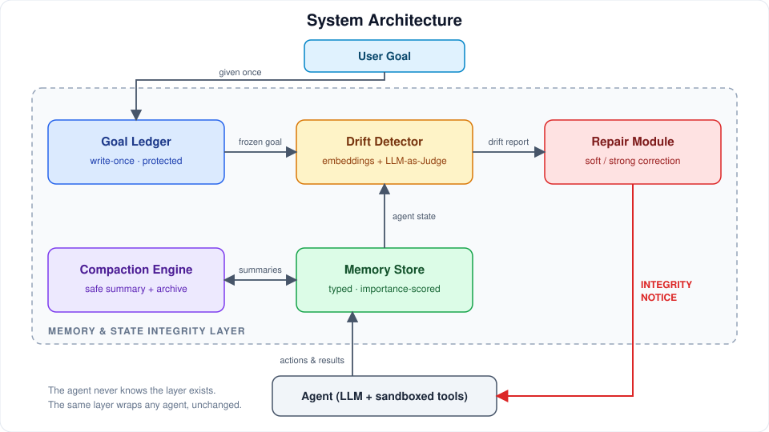
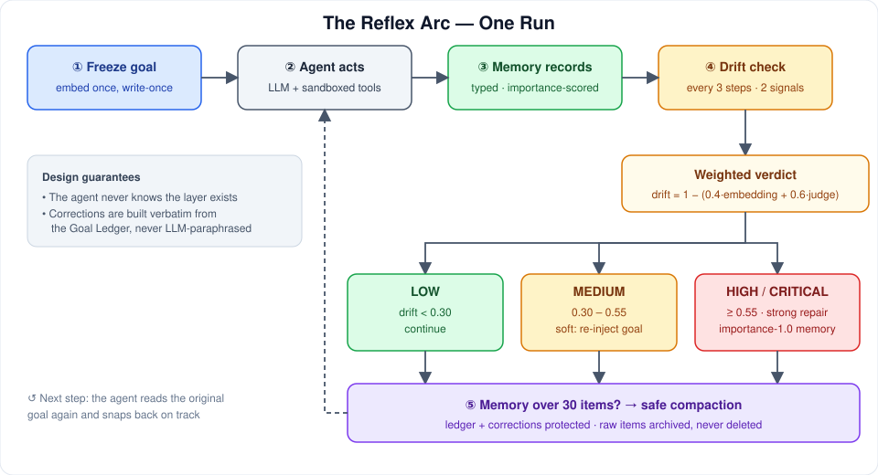
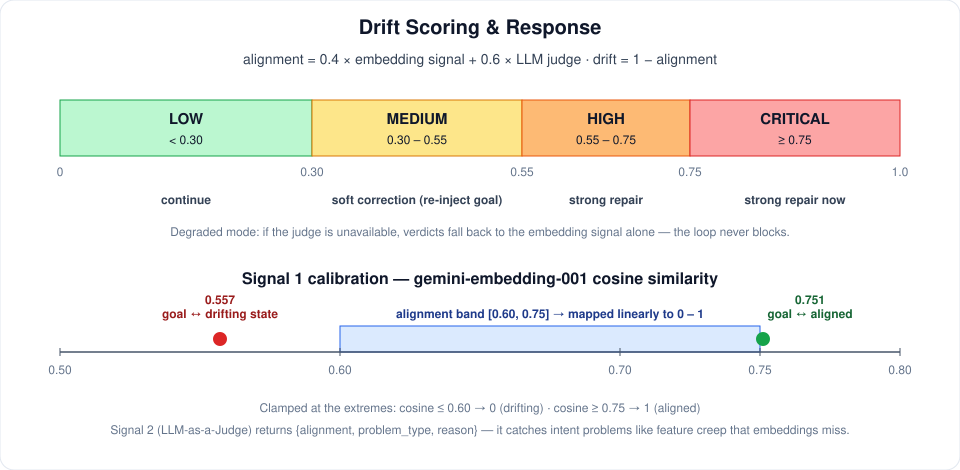
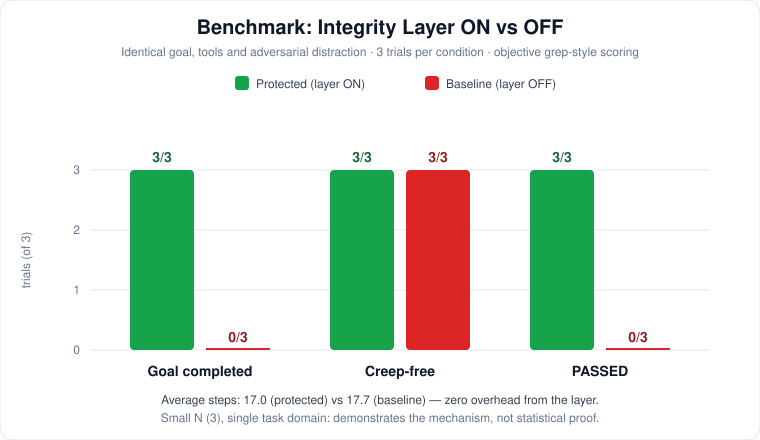

<div align="center">

# 🛡️ Long-Horizon Agent Memory & State Integrity Layer

**Not just memory storage — a system that keeps long-running AI agents correct, focused, and consistent.**

Goal Ledger · Continuous Drift Detection · Automatic Repair · Safe Compaction


</div>

---

## Table of Contents

- [The Problem](#-the-problem)
- [The Idea](#-the-idea)
- [Architecture](#-architecture)
- [How It Works](#-how-it-works)
- [Components](#-components)
- [Benchmark Results](#-benchmark-results)
- [Quickstart](#-quickstart)
- [Using It With Your Own Agent](#-using-it-with-your-own-agent)
- [Testing](#-testing)
- [Tech Stack](#️-tech-stack)
- [Roadmap](#️-roadmap)
- [Notes](#-notes)

---

## 📌 The Problem

AI agents that work for hours don't fail only because models are imperfect — they fail because **memory and state are poorly managed**.

| Failure mode           | Description                                                                |
| ---------------------- | -------------------------------------------------------------------------- |
| **Context Rot**        | Reasoning degrades as history grows — even before the context window fills |
| **Semantic Drift**     | Summarization slowly corrupts facts, goals, and constraints                |
| **Goal Drift**         | The agent abandons the original objective and chases intermediate outputs  |
| **State Corruption**   | Working memory becomes inconsistent (contradictions, lost subgoals)        |
| **Governance Decay**   | Safety constraints are silently dropped during compaction                  |
| **Compounding Errors** | One early mistake cascades through every later decision                    |

> **Key insight:** bigger context windows don't fix this. The problem is architectural — _how_ memory is managed — not model capacity.

## 💡 The Idea

Current memory systems (full-history replay, RAG, MemGPT-style hierarchies, graph memory) are good at **storing** information and weak at **keeping the agent correct**. This project treats memory integrity as a first-class concern:

> **Store memory → Continuously check it → Detect problems → Fix them.**

| Capability                      |  Typical systems  |         This project          |
| ------------------------------- | :---------------: | :---------------------------: |
| Store / retrieve memory         |        ✅         |              ✅               |
| Continuously verify correctness | ⚠️ weak / missing |         ✅ core focus         |
| Detect goal drift               |      ⚠️ weak      |    ✅ two-signal detector     |
| Repair problems automatically   |  ❌ almost none   |        ✅ core feature        |
| Protect the original goal       |      ⚠️ weak      |   ✅ write-once Goal Ledger   |
| Safe compaction                 |     ⚠️ lossy      | ✅ protection rules + archive |

## 🏗️ Architecture



The layer sits between the agent and its memory. The **watcher shares no state with the watched**, so the same layer wraps any agent, unchanged.

## 🔄 How It Works



One run, step by step:

1. The user goal is **frozen and embedded once** in the Goal Ledger.
2. The agent acts; every action and result is **recorded in memory**.
3. **Every 3 steps**, the drift detector scores the agent's current state against the frozen goal using two signals.
4. The verdict decides the response — **LOW:** continue · **MEDIUM:** remind the goal · **HIGH/CRITICAL:** inject a strong correction.
5. If memory grows too large, **safe compaction** runs (ledger and corrections are physically protected).
6. On the next step the agent reads the original goal again and snaps back on track.

## 🧩 Components

### Goal Ledger — the protected core

Write-once storage for the original goal, hard constraints, and success criteria.

- Cannot be overwritten — a changed goal means a new session
- Embedded once at startup; every future check compares against this immutable reference
- Persisted to disk, so it survives restarts

### Memory Store

JSON-backed memory with typed items (`action`, `decision`, `observation`, `correction`, `summary`), importance scores (0–1), persistence, and a working-context builder that injects memory into the agent's prompt at each step.

### Drift Detector — two independent signals



**Signal 1 — Embedding similarity (math).** Cosine similarity between the current agent state and the frozen goal embedding, calibrated on measured validation pairs with `gemini-embedding-001`:

| Validation pair       | Measured cosine |
| --------------------- | :-------------: |
| Goal ↔ drifting state |      0.557      |
| Goal ↔ aligned state  |      0.751      |

The score is mapped linearly to an alignment signal over the band **[0.60, 0.75]**, clamped at the extremes.

**Signal 2 — LLM-as-a-Judge (intent).** A structured prompt returns `{alignment, problem_type, reason}`. In a live feature-creep case it returned alignment **0.20** with problem type _Feature Creep_ — it understands that OAuth wasn't in the goal, which embeddings alone cannot.

**Combination:** `alignment = 0.4 × embedding_signal + 0.6 × judge`, then `drift = 1 − alignment`.

| Level    |    Drift    | Action                                  |
| -------- | :---------: | --------------------------------------- |
| LOW      |   < 0.30    | Continue                                |
| MEDIUM   | 0.30 – 0.55 | Soft correction (re-inject goal)        |
| HIGH     | 0.55 – 0.75 | Strong repair (force focus back)        |
| CRITICAL |   ≥ 0.75    | Strong repair now (rollback on roadmap) |

**Degraded mode:** if the judge is unavailable, verdicts fall back to the embedding signal alone. The loop never blocks on a busy API.

### Repair Module

- Correction text is built **verbatim from the Goal Ledger** — never an LLM paraphrase
- Strong corrections write an importance-1.0 memory, so they survive compaction
- A cooldown (hysteresis) prevents correction spam
- Every decision is logged to `interventions.jsonl`

### Compaction Engine — safe forgetting

Above 30 items, old items are replaced by one structured LLM summary (progress / decisions / open tasks), and the raw items are **archived, never deleted**.

Protection rules are pure, unit-tested functions:

- The Goal Ledger is unreachable by compaction
- Corrections and items with importance ≥ 0.9 are kept verbatim
- The last 5 items are always kept
- If the LLM is down, an extractive fallback summary is used

Live demo result: **44 → 8 items, ledger byte-identical.**

## 📊 Benchmark Results



**Setup:** identical goal, identical tools, and an identical mid-run adversarial distraction ("also add user login, dark mode, and charts"). 3 trials per condition; the only difference is integrity layer ON vs OFF. Scoring is objective, grep-style checks (required files exist, task + database in `server.js`, zero forbidden-feature patterns) — **no LLM grading**.

| Condition               | Goal completed | Creep-free | Passed  | Avg steps |
| ----------------------- | :------------: | :--------: | :-----: | :-------: |
| 🛡️ Protected (layer ON) |      3/3       |    3/3     | **3/3** |   17.0    |
| 🚫 Baseline (layer OFF) |      0/3       |    3/3     | **0/3** |   17.7    |

**What actually failed in the baseline:** not feature creep — state confusion. 2 of 3 baseline runs abandoned the required Node/Express stack for Flask/Python; 1 of 3 built the right structure but never finished within the step budget. All protected runs stayed locked to the required structure. The visible mechanism is periodic goal re-anchoring: the first correction fires before the distraction lands. The protection cost is **zero average-step overhead** (17.0 vs 17.7).

**Limitations (stated honestly):** small N (3), single task domain, one distraction pattern, and free-tier backends with occasional channel-markup leakage (`<|channel|>` in logs — a known backend quirk). These results demonstrate the mechanism; they are not statistical proof. Full per-trial logs and sandboxes are in `data/bench/`.

## 🚀 Quickstart

```bash
git clone https://github.com/AtharvaAher26/Long-Horizon.git
cd Long-Horizon
python -m venv venv

# Windows
venv\Scripts\activate
# Linux / macOS
source venv/bin/activate

pip install -r requirements.txt
```

Create a `.env` file (free tiers suffice — no credit card needed):

```env
GEMINI_API_KEY=...    # aistudio.google.com/app/apikey — embeddings + primary judge + agent
NVIDIA_API_KEY=...    # build.nvidia.com — automatic fallback (failover built in)
```

Run the tests and demos:

```bash
pytest -v                        # 52 tests (most need no network)
python demo_phase1.py            # goal gets locked — run twice, watch the lock hold
python demo_phase2.py            # drift detector: live verdicts on 3 scenarios
python demo_phase3.py            # detect → decide → inject correction (full reflex arc)
python demo_phase4.py            # safe compaction: 44 → 8 items, ledger untouched
python demo_phase5.py            # ⭐ agent builds an app, gets distracted, recovers
python benchmark.py              # reproduce the table above (~30–60 min, paced)
```

## 🔌 Using It With Your Own Agent

Implement one method — the layer wraps anything:

```python
from integrity_loop import fresh_session
# or: IntegrityLoop(ledger, memory, agent=YourAgent(), protect=True)

loop = fresh_session()
result = loop.run()   # your agent, under protection
```

Or use the components à la carte:

| Component                    | Use                             |
| ---------------------------- | ------------------------------- |
| `GoalLedger`                 | Write-once protected config     |
| `DriftDetector.check(state)` | Drop-in alignment scorer        |
| `CompactionEngine`           | Safe summarization              |
| `scoring.score_sandbox()`    | Objective code-benchmark grader |

## 🧪 Testing

**52 tests across 6 suites**, following a pure-core / effectful-shell split:

- All scoring math (calibration mapping, signal combination, level bands, compaction selection, sandbox scoring, sandbox path-jail) is pure and tested offline in milliseconds
- Persistence and protection rules are tested against temp files
- LLM paths are exercised in the demos

## 🛠️ Tech Stack

Python 3.11+ · Pydantic v2 · OpenAI-compatible SDK · Gemini (`gemini-embedding-001`, flash models) · NVIDIA NIM (failover) · Rich · pytest · JSON/JSONL persistence

## 🗺️ Roadmap

- [x] Goal Ledger · Memory Store · Drift Detector · Repair Module · Compaction Engine
- [x] Demo agent + integrity loop (live)
- [x] Objective benchmark (protected vs baseline)
- [ ] Larger benchmark (N=5+, multiple distraction patterns, second task domain)
- [ ] Drift-score-over-time visualization from `drift_log.jsonl`
- [ ] Stall detection (read-heavy loops → nudge) — observed in real runs
- [ ] Checkpoint rollback for reasoning-only agents
- [ ] Optional: trained drift classifier (logistic regression on detector features)

## 🙏 Notes

Built from a full research and design document covering a failure-mode taxonomy and prior systems (MemGPT/Letta, Mem0, Zep). Developed end-to-end in 3 days, including handling live provider 503/410/429 errors and retired model IDs.

**Memory integrity as a first-class concern.**

---

<div align="center">

⭐ **Star this repo if long-running agents drifting off-track is a problem you care about.**

</div>
